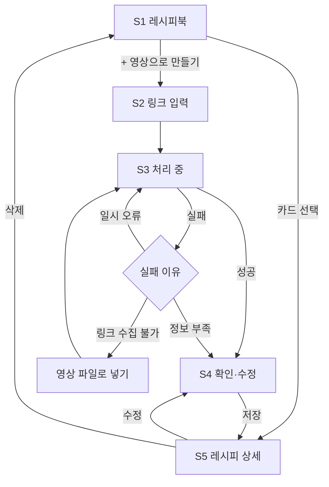

# 숏폼 레시피 서비스 UX 플로우 v0.2

작성: 송유란 · 2026-10-19 · 팀 검토용 초안
변경: 기획안 v0.4(MVP 축소)에 맞춰 v0.1을 다시 씀. 냉장고·요리 도우미 화면 삭제. 근거·미확인 표시는 `schemas/recipe.schema.json`, `schemas/evidence_bundle.schema.json` 기준.

> **[결정 필요]** 표시는 팀이 정해야 하는 부분이다. 옆에 적은 내용은 유란의 제안이며 확정이 아니다.

## 1. MVP 범위

영상 링크 → 텍스트 레시피(근거·미확인 표시) → 확인·수정 → 내 레시피북.
냉장고 인식, 요리 도우미(추천·대체), 재고, 단위 환산은 **화면에 넣지 않는다**(기획안 보류 메모).

## 2. 화면 목록

모바일 웹 기준. 하단 탭은 두지 않는다(화면 수가 적어서) — **[결정 필요]**

| # | 화면 | 하는 일 | 대표 행동 |
|---|---|---|---|
| S1 | 레시피북(홈) | 저장한 레시피 카드 목록, 빈 상태 | [+ 영상으로 레시피 만들기] |
| S2 | 링크 입력 | YouTube Shorts 링크 붙여넣기, 지원 범위 안내 | [레시피 만들기] / [영상 파일로 넣기] |
| S3 | 처리 중 | 진행 단계 표시, 중복 제출 방지 | (기다리기) |
| S4 | 레시피 확인·수정 | 요리명·재료·분량·순서, 근거, 미확인 표시, 바로 고치기 | [레시피북에 저장] |
| S5 | 레시피 상세 | 저장한 레시피 보기, 출처 영상 링크 | [수정] / [삭제] |

- 처리 실패는 S3 안의 상태로 보여 준다(화면 이동 줄이기).
- 홈을 S1(레시피북)으로 할지 S2(링크 입력)로 할지 — **[결정 필요]** 제안: S1. 다시 보러 오는 곳이 레시피북이고, 빈 상태에서 바로 S2로 안내할 수 있다.

## 3. 전체 흐름

## 4. 화면별 내용

### S1 레시피북(홈)

- 카드: 요리명, 재료 수, **미확인 분량 개수**(예: "분량 확인 필요 2"), 저장일.
- 빈 상태: "저장해 둔 요리 숏폼, 텍스트 레시피로 바꿔 보세요." + [영상으로 레시피 만들기].
- 처리 중인 작업이 있으면 맨 위에 "레시피 만드는 중" 카드를 보여 준다 — **[결정 필요]** (S3를 떠날 수 있게 할지에 달림)

### S2 링크 입력

- 안내: "YouTube Shorts 요리 영상만 지원해요." (인스타 릴스·틱톡은 보류)
- 링크 형식이 틀리면 버튼을 누르기 전에 입력칸 아래에 알려 준다.
- [영상 파일로 넣기]: 사용 권한이 있는 영상만 올리도록 안내 문구를 붙인다.

### S3 처리 중

- 파이프라인 단계를 사용자 말로 바꿔 보여 준다: 영상 가져오는 중 → 말소리 읽는 중 → 화면 글자 읽는 중 → 레시피 정리 중.
- 버튼은 비활성화해 같은 링크를 두 번 보내지 않게 한다.
- 오래 걸릴 때 화면을 떠났다가 돌아올 수 있게 할지 — **[결정 필요]** 제안: 가능하게. 영상 길이에 따라 시간이 들쭉날쭉하다.

**실패 상태**

| 실패 이유 | 문구 방향 | 행동 |
|---|---|---|
| 일시 오류 | "잠시 문제가 생겼어요." | [다시 시도] |
| 링크로 영상을 가져올 수 없음 | "이 영상은 링크로 가져올 수 없어요." | [영상 파일로 넣기] / [다른 링크] |
| 레시피 정보가 부족함 | "영상에서 찾은 정보가 적어요." | [찾은 만큼 보기] / [다른 영상] |

영상에 없는 내용을 채워 넣은 "완성 레시피"처럼 보이게 만들지 않는다.

### S4 레시피 확인·수정 (핵심 화면)

수정하기 쉬워야 데이터도 쌓이므로 가장 공들이는 화면이다.

- 순서: 요리명 → (인분, 있을 때만) → 재료 목록 → 조리 순서 → 출처 영상.
- **재료 한 줄** = 이름 + 분량 + 근거 표시.
  - 분량 확인됨(`confirmed`): 영상에 나온 그대로 보여 준다(예: "1큰술", "적당히"). 단위를 바꾸지 않는다.
  - 분량 미확인(`unconfirmed`): **"영상에서 확인되지 않음"** 을 눈에 띄게 표시하고, 탭하면 바로 입력할 수 있게 한다.
  - 영상 표기가 다르면 작게 원문을 함께 보여 준다(예: 식용유 · 영상 표기 "기름").
  - 선택 재료(`optional`)는 "선택" 배지.
  - 근거가 하나도 없는 재료(`evidence: []`)는 "영상에서 보이기만 함" 표시 — **[결정 필요]** 표현 방법
- 고치는 방식: 화면 안에서 바로 고치기(인라인 편집) vs [수정] 버튼으로 편집 모드 — **[결정 필요]** 제안: 인라인 편집. 미확인 분량을 탭 한 번에 채울 수 있다.
- 재료·단계 추가, 삭제, 순서 바꾸기를 지원한다.
- 저장 버튼 근처에 안내: "고친 내용은 원래 결과와 함께 보관되어 추출 품질을 높이는 데 쓰여요." (기획안 필수 안내) — 위치는 **[결정 필요]**
- 저장 실패 시 고친 내용을 잃지 않고 [다시 저장]을 보여 준다.

### S5 레시피 상세

- S4와 같은 배치를 읽기 전용으로 보여 준다. 미확인 분량 표시는 그대로 남긴다.
- [원본 영상 보기], [수정](→ S4), [삭제](확인 대화상자를 거친다).

## 5. 근거 표시

데이터: 재료와 조리 단계마다 `evidence`에 근거 조각 id 목록이 있다(예: `["ocr-0", "asr-1"]`). 각 조각은 아래 종류 중 하나다.

| 데이터 값 | 화면 표기 | 영상 시각 |
|---|---|---|
| `asr` | 말소리 | 있음 (예: 0:06) |
| `ocr` | 화면 글자 | 있음 |
| `description` | 영상 설명 | 없음 |
| `title` | 제목 | 없음 |

- 기본은 재료 줄 끝에 작은 표시(예: "말소리 0:06"), 탭하면 근거 원문을 펼친다 — 항상 보일지, 탭했을 때만 보일지 **[결정 필요]**
- 영상 시각을 누르면 그 시점부터 영상을 열 수 있으면 좋다(가능 여부는 수빈 확인 필요).

## 6. 빈 상태·오류 정리

| 상황 | 다음 행동 |
|---|---|
| 저장한 레시피 없음 | [영상으로 레시피 만들기] |
| 지원하지 않는 링크 | 지원 범위 안내, 입력 유지 |
| 처리 실패 | 3절 실패 상태 표 |
| 저장 실패 | 고친 내용 보존 + [다시 저장] |
| 삭제 | 확인 후 삭제, 레시피북으로 이동 |

## 7. 팀에 확인할 것

1. 홈을 레시피북(S1)으로 할지, 링크 입력(S2)으로 할지?
2. S4 수정 방식: 인라인 편집 vs 편집 모드?
3. 근거를 항상 보일지, 탭할 때만 보일지?
4. 품질 개선 안내 문구를 어디에 둘지?
5. 처리 중에 화면을 떠났다 돌아올 수 있게 할지?
6. 로그인: 체험 계정으로 시작할지, 처음부터 로그인할지? (레시피북은 사용자별이라 필요)
7. (수빈) 저장된 레시피에서 영상 시각으로 바로 이동할 수 있는지?
8. (선규) 웹 API가 근거 조각(segment) 원문을 레시피와 함께 내려주는지?

## 8. 다음 단계

이 문서가 합의되면 S2 → S3 → S4 순서로 와이어프레임을 만들고(1주차 범위), S4의 근거·미확인 표시는 2주차에 다듬는다.
