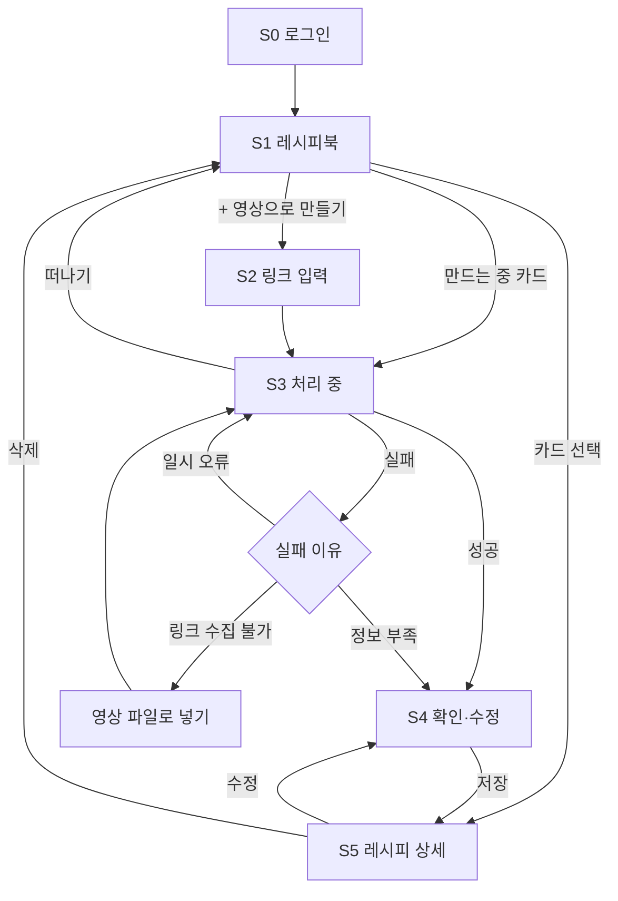

# 숏폼 레시피 서비스 UX 플로우 v0.3

작성: 송유란 · 2026-10-19 · 팀 검토용
변경: v0.2 리뷰(#4)에서 받은 선규·수빈 답변 반영. 홈·수정 방식·근거 표시·처리 중 이탈·로그인 확정, 영상 시각 이동 방법 추가. 스키마와 맞춰야 할 항목은 #3에서 정한다.
근거·미확인 표시는 `schemas/recipe.schema.json`, `schemas/evidence_bundle.schema.json` 기준.

> **[결정 필요]** 는 아직 팀이 정하지 않은 부분, **[#3 대기]** 는 스키마·API 논의(#3) 결과를 기다리는 부분이다.

## 1. MVP 범위

영상 링크 → 텍스트 레시피(근거·미확인 표시) → 확인·수정 → 내 레시피북.
입력은 **YouTube Shorts**로 제한한다(링크 수집이 막히면 영상 파일 업로드).
냉장고 인식, 요리 도우미(추천·대체), 재고, 단위 환산은 **화면에 넣지 않는다**(기획안 보류 메모).

## 2. 화면 목록

모바일 웹 기준. 하단 탭은 두지 않는다(화면 수가 적어서) — **[결정 필요]**

| # | 화면 | 하는 일 | 대표 행동 |
|---|---|---|---|
| S0 | 로그인 | 처음 한 번 간단한 로그인 | [로그인] |
| S1 | 레시피북(홈) | 저장한 레시피 카드 목록, 만드는 중 카드, 빈 상태 | [+ 영상으로 레시피 만들기] |
| S2 | 링크 입력 | YouTube Shorts 링크 붙여넣기, 지원 범위 안내 | [레시피 만들기] / [영상 파일로 넣기] |
| S3 | 처리 중 | 진행 단계 표시, 중복 제출 방지, 떠나기 가능 | (기다리기) / [레시피북으로] |
| S4 | 레시피 확인·수정 | 요리명·재료·분량·순서, 근거, 미확인 표시, 인라인 편집 | [레시피북에 저장] |
| S5 | 레시피 상세 | 저장한 레시피 보기, 출처 영상 | [수정] / [삭제] |

- 홈은 **S1 레시피북**이다. 다시 보러 오는 곳이 레시피북이고, 빈 상태에서 바로 S2로 안내할 수 있다.
- 처리 실패는 S3 안의 상태로 보여 준다(화면 이동 줄이기).

## 3. 전체 흐름

## 4. 화면별 내용

### S0 로그인

- 처음부터 간단한 로그인으로 시작한다. 레시피북이 사용자별이라 필요하다.
- 체험 계정은 쓰지 않는다. 나중에 계정 연결·데이터 이전이 생겨 5주 일정에 부담이다.
- 방식은 구글 로그인 또는 이메일 링크 중 **하나** — **[결정 필요]**
- 로그인 화면에는 서비스 한 줄 소개와 버튼 하나만 둔다.

### S1 레시피북(홈)

- 카드: 요리명, 재료 수, **미확인 분량 개수**(예: "분량 확인 필요 2"), 저장일.
- 처리 중인 작업이 있으면 맨 위에 **"레시피 만드는 중"** 카드를 보여 준다. 누르면 S3로 간다. 실패하면 카드에 실패 표시를 하고 누르면 S3 실패 상태로 간다.
- 빈 상태: "저장해 둔 요리 숏폼, 텍스트 레시피로 바꿔 보세요." + [영상으로 레시피 만들기].

### S2 링크 입력

- 안내: "YouTube Shorts 요리 영상만 지원해요." (인스타 릴스·틱톡은 보류)
- 링크 형식이 틀리면 버튼을 누르기 전에 입력칸 아래에 알려 준다.
- [영상 파일로 넣기]: 사용 권한이 있는 영상만 올리도록 안내 문구를 붙인다.

### S3 처리 중

- 파이프라인 단계를 사용자 말로 바꿔 보여 준다: 영상 가져오는 중 → 말소리 읽는 중 → 화면 글자 읽는 중 → 레시피 정리 중.
- 버튼은 비활성화해 같은 링크를 두 번 보내지 않게 한다.
- **화면을 떠날 수 있다.** "다 되면 레시피북에서 볼 수 있어요." + [레시피북으로]. 작업은 S1의 "만드는 중" 카드로 이어진다.
- 진행 단계 4개와 실패 이유 3개는 jobs 상태값·오류 코드로 고정한다 — **[#3 대기]** (수빈·선규)

**실패 상태**

| 실패 이유 | 문구 방향 | 행동 |
|---|---|---|
| 일시 오류 | "잠시 문제가 생겼어요." | [다시 시도] |
| 링크로 영상을 가져올 수 없음 | "이 영상은 링크로 가져올 수 없어요." | [영상 파일로 넣기] / [다른 링크] |
| 레시피 정보가 부족함 | "영상에서 찾은 정보가 적어요." | [찾은 만큼 보기] / [다른 영상] |

- 재료·단계를 **하나도** 찾지 못한 경우: 스키마가 재료·단계 최소 1개를 요구해서, 이때 S4에 무엇을 보여 줄지와 파이프라인 상태값을 정해야 한다 — **[#3 대기]**
- 영상에 없는 내용을 채워 넣은 "완성 레시피"처럼 보이게 만들지 않는다.

### S4 레시피 확인·수정 (핵심 화면)

수정하기 쉬워야 데이터도 쌓이므로 가장 공들이는 화면이다.

- 순서: 요리명 → (인분, 있을 때만) → 재료 목록 → 조리 순서 → 출처 영상.
- **고치는 방식은 인라인 편집**: 따로 편집 모드에 들어가지 않고 화면에서 바로 고친다. 미확인 분량은 탭 한 번에 입력할 수 있다.
- **재료 한 줄** = 이름 + 분량 + 근거 표시.
  - 분량 확인됨(`confirmed`): 영상에 나온 그대로 보여 준다(예: "1큰술", "적당히"). 단위를 바꾸지 않는다.
  - 분량 미확인(`unconfirmed`): **"영상에서 확인되지 않음"** 을 눈에 띄게 표시하고, 탭하면 바로 입력할 수 있다.
  - 사용자가 직접 채운 분량·추가한 재료: **"직접 입력"** 으로 표시해 영상에서 확인한 값과 구분한다. 저장 형식(예: `amount_status: user_entered`)은 **[#3 대기]** — 지금 스키마는 `confirmed`면 근거가 1개 이상 있어야 해서 그대로는 저장 검증에 걸린다.
  - 영상 표기가 다르면 작게 원문을 함께 보여 준다(예: 식용유 · 영상 표기 "기름").
  - 선택 재료(`optional`)는 "선택" 배지.
  - 근거가 하나도 없는 재료(`evidence: []`)는 "영상에서 보이기만 함" 표시 — 표현은 **[결정 필요]**
- 재료·단계 추가, 삭제, 순서 바꾸기를 지원한다.
- 저장 버튼 근처에 안내: "고친 내용은 원래 결과와 함께 보관되어 추출 품질을 높이는 데 쓰여요." (기획안 필수 안내) — 위치는 **[결정 필요]**
- 저장 실패 시 고친 내용을 잃지 않고 [다시 저장]을 보여 준다.

### S5 레시피 상세

- S4와 같은 배치를 읽기 전용으로 보여 준다. 미확인 분량 표시는 그대로 남긴다.
- 분량마다 **"영상에서 확인"** 과 **"직접 입력"** 을 구분해 보여 준다.
- [원본 영상 보기]
  - 링크로 만든 레시피: YouTube 영상을 연다.
  - 업로드 영상으로 만든 레시피: 원본 링크가 없으므로 우리 플레이어로 연다. 업로드 영상을 계속 보관할지(개인정보 최소화 원칙)는 **[결정 필요]** — 보관하지 않으면 이 버튼을 숨긴다.
- [수정](→ S4), [삭제](확인 대화상자를 거친다).

## 5. 근거 표시

데이터: 재료와 조리 단계마다 `evidence`에 근거 조각(segment) id 목록이 있다(예: `["ocr-0", "asr-1"]`). 레시피 API는 참조하는 조각의 `type`, `text`, `start_ms`/`end_ms`를 함께 내려준다(선규 확인).

| 데이터 값 | 화면 표기 | 영상 시각 |
|---|---|---|
| `asr` | 말소리 | 있음 (예: 0:06) |
| `ocr` | 화면 글자 | 있음 |
| `description` | 영상 설명 | 없음 |
| `title` | 제목 | 없음 |

- #3에서 고정 댓글(`comment`) 타입이 들어가면 "고정 댓글(시각 없음)" 행을 추가한다 — **[#3 대기]**
- **짧은 표시는 항상 보인다**: 재료·단계 줄 끝에 "말소리 0:06"처럼. **원문은 탭해서 펼친다.**

### 영상 시각으로 이동

- YouTube: `youtube.com/watch?v=<영상ID>&t=<초>s` 링크나 임베드 플레이어의 `start` 값으로 특정 시점부터 연다. 정밀도는 초 단위.
- 업로드 영상: 우리 플레이어에서 시각을 지정한다.
- 모바일에서 YouTube 앱으로 열리면 시각이 무시될 수 있다. 그래서 앱 안 임베드 플레이어로 여는 것을 우선한다 — **[결정 필요]**
- 말소리 시작보다 1~2초 앞에서 열어 문장 앞부분이 잘리지 않게 한다(제안).

## 6. 빈 상태·오류 정리

| 상황 | 다음 행동 |
|---|---|
| 저장한 레시피 없음 | [영상으로 레시피 만들기] |
| 지원하지 않는 링크 | 지원 범위 안내, 입력 유지 |
| 처리 실패 | 4절 S3 실패 상태 표 |
| 저장 실패 | 고친 내용 보존 + [다시 저장] |
| 삭제 | 확인 후 삭제, 레시피북으로 이동 |

## 7. 결정 기록

| 항목 | 결정 | 출처 |
|---|---|---|
| 입력 범위 | YouTube Shorts만. S2 안내 문구 유지 | 수빈 (#4) |
| 홈 | S1 레시피북 | 선규 (#4) |
| S4 수정 방식 | 인라인 편집 | 선규 (#4) |
| 근거 표시 | 짧은 표시는 항상, 원문은 탭해서 펼치기 | 선규 (#4) |
| 처리 중 떠나기 | 허용 + S1 "만드는 중" 카드 | 선규 (#4) |
| 로그인 | 처음부터 간단한 로그인. 체험 계정 없음 | 선규 (#4) |
| 영상 시각 이동 | 가능(초 단위). 모바일 YouTube 앱에선 무시될 수 있음 | 수빈 (#4) |
| 근거 원문 제공 | API가 segment의 type·text·시각을 함께 내려줌 | 선규 (#4) |

## 8. 남은 질문

**#3에서 정할 것 (2주차 S4 구현 전까지)**
1. 사용자가 채운 분량·추가한 재료의 저장 형식(`user_entered` 등)
2. 재료·단계를 하나도 못 찾았을 때 S4 표시와 파이프라인 상태값
3. S3 진행 단계 4개·실패 이유 3개의 jobs 상태값·오류 코드 (수빈·선규)
4. 고정 댓글(`comment`) 근거 타입 추가 여부

**팀에서 정할 것**
5. 로그인 방식: 구글 vs 이메일 링크
6. 하단 탭 없이 갈지
7. 품질 개선 안내 문구 위치
8. 근거 없는 재료(`evidence: []`) 표현
9. 업로드 영상 보관 여부(S5 [원본 영상 보기] 노출)
10. 모바일에서 앱 안 임베드 플레이어 우선 여부

## 9. 다음 단계

S2 → S3 → S4 순서로 와이어프레임을 만든다(1주차 범위). S4의 근거·미확인·직접 입력 표시는 #3 결과를 받아 2주차에 다듬는다.
