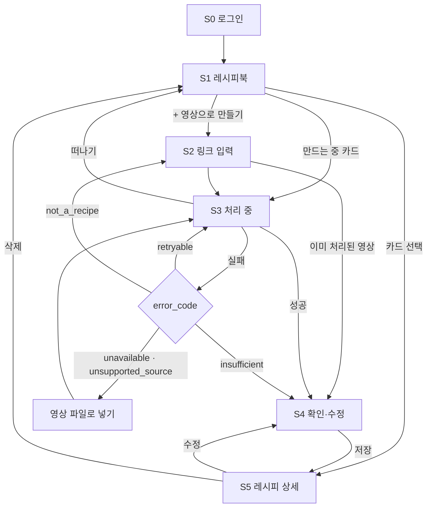

# 숏폼 레시피 서비스 UX 플로우 v0.4

작성: 송유란 · 2026-10-22 · 팀 검토용
변경: 개발 계획 v0.8(#8)의 화면 범위에 맞춰 다시 씀. 항목별 근거·출처·시각 이동·신뢰도 요약을 화면에서 제외하고, 확인되지 않은 분량은 "영상에서 확인 안 됨"으로 비워 둔다. 실패 안내를 `error_code` 4종으로, 처리 중 화면을 `jobs.stage` 기준으로 바꿈. #9 리뷰 반영: 미확인 분량 문구 변경, 상태 단순화 의도 명시, Shorts 전용 이유, 업로드 원본 보관 표현 통일. #8 병합으로 화면 범위 확정, 절충안은 MVP 이후 검토 후보로 이동.
관련 문서: [기획안](plan.md) · [개발 계획](dev-plan.md)

> **[결정 필요]** 는 팀이 아직 정하지 않은 부분, **[#3 대기]** 는 스키마·API 논의(#3) 결과를 기다리는 부분이다.

## 1. MVP 흐름

**로그인 → 링크 입력 → 처리 중 → 레시피 확인·수정 → 저장 → 내 레시피북**

- 입력은 **YouTube Shorts 링크**와 영상 파일 업로드. Instagram은 10/27 지원 결정 후 반영한다.
- 화면 범위는 #8(개발 계획 v0.8)로 **확정**됐다. 확인되지 않은 분량은 비우고, 신뢰도 요약 등 절충안은 MVP에 넣지 않는다. 절충안은 9절 "MVP 이후 검토 후보"에 둔다.
- 결과 화면은 **요리명·재료·원문 분량·조리 순서**만 보여 준다.
- 화면에 넣지 않는 것: 항목별 근거·원문·출처, 영상 시각 이동, 신뢰도 요약, 출처 충돌 표시, 팁·소제목·손질법. 근거·시각·검증 상태는 내부 검증·평가용으로만 쓴다(개발 계획 v0.8).
- 차별점이 화면에 드러나는 곳은 **"영상에서 확인 안 됨"** 이다. 영상에서 확인되지 않은 분량을 지어내지 않고 비워 둔다는 원칙을 사용자가 직접 본다.

## 2. 화면 목록

모바일 웹 기준. 하단 탭은 두지 않는다 — **[결정 필요]**

| # | 화면 | 하는 일 | 대표 행동 |
|---|---|---|---|
| S0 | 로그인 | 구글 로그인 | [Google로 계속하기] |
| S1 | 레시피북(홈) | 저장한 레시피 목록, "만드는 중" 카드, 빈 상태 | [+ 영상으로 레시피 만들기] |
| S2 | 링크 입력 | Shorts 링크 붙여넣기, 영상 파일 대안 | [레시피 만들기] / [영상 파일로 넣기] |
| S3 | 처리 중 | 지금 하는 단계 한 줄, 떠나기 가능, 실패 안내 | [레시피북으로] |
| S4 | 레시피 확인·수정 | 요리명·재료·분량·순서, 인라인 편집, 직접 입력·되돌리기 | [레시피북에 저장] |
| S5 | 레시피 상세 | 저장한 레시피 보기 | [수정] / [삭제] / [원본 영상] |

## 3. 전체 흐름

## 4. 화면별 내용

### S0 로그인

- 구글 로그인 하나만 둔다. 체험 계정은 없다.
- 서비스 한 줄 소개 + [Google로 계속하기].

### S1 레시피북(홈)

- 카드: 요리명, 재료 수, 저장일.
- 처리 중인 작업은 맨 위 **"레시피 만드는 중"** 카드로 보여 준다. 누르면 S3, 실패했으면 카드에 실패 표시 후 S3 실패 상태로 간다.
- 동시에 여러 작업을 만들 수 있게 할지(카드 여러 장 vs 하나) — **[#3 대기]**
- 빈 상태: "저장해 둔 요리 숏폼, 텍스트 레시피로 바꿔 보세요." + [영상으로 레시피 만들기].

### S2 링크 입력

- 안내: "YouTube Shorts 요리 영상 링크를 붙여 넣어 주세요."
- 입력칸 옆 [붙여넣기] 버튼으로 복사한 링크를 바로 넣는다.
- Shorts 링크가 아니면 버튼을 누르기 전에 입력칸 아래에 알려 준다.
  - 다른 YouTube 링크·형식 오류: "YouTube Shorts 링크가 아니에요."
  - Instagram·TikTok 등: "아직 YouTube Shorts만 지원해요."
- **일반 YouTube(`watch`) 링크는 받지 않는다.** 파이프라인은 처리할 수 있지만 MVP에서는 의도적으로 막는다.
  - 서비스 대상이 "요리 숏폼"이고, 평가셋·정답 데이터·지인 테스트도 Shorts 기준이다. 입력 범위를 평가 범위와 맞춰야 보여 주는 품질과 실제 품질이 같다.
  - 긴 영상은 처리 시간·비용이 늘고 레시피 구조(여러 요리, 긴 설명)가 달라 실패 안내가 늘어난다.
  - 길이 제한은 영상을 가져온 뒤에야 알 수 있어 사용자가 기다린 다음 실패를 보게 된다. 링크 형식은 입력하는 순간 알려 줄 수 있다.
  - MVP 이후 일반 링크를 열 때는 길이 제한과 함께 다시 검토한다.
- [영상 파일로 넣기]: "직접 찍었거나 사용 권한이 있는 영상만 올려 주세요. 올린 영상은 레시피를 만든 뒤 지워져요." 업로드 원본은 처리·재시도에 필요한 동안만 임시 보관 후 삭제한다. 정확한 기간은 **[#3 대기]**
- **이미 처리된 영상**이면(같은 영상 재사용) S3를 건너뛰고 바로 S4로 간다.

### S3 처리 중

- 단계 목록 대신 **지금 하는 단계 한 줄**만 보여 준다. 영상마다 실행하는 단계 수가 다르기 때문이다.
  - `jobs.stage` → 문구: 수집 "영상 가져오는 중…" / 음성 "말소리 읽는 중…" / 화면 글자 "화면 글자 읽는 중…" / 정리 "레시피 정리하는 중…"
- 버튼을 비활성화해 같은 링크를 두 번 보내지 않게 한다.
- **화면을 떠날 수 있다.** "화면을 나가도 계속 만들어요. 다 되면 레시피북에서 볼 수 있어요." + [레시피북으로].

**실패 안내** (`error_code`와 1:1)

| error_code | 문구 방향 | 행동 |
|---|---|---|
| `retryable` | "잠시 문제가 생겼어요." | [다시 시도] |
| `unavailable` · `unsupported_source` | "이 영상은 링크로 가져올 수 없어요." | [영상 파일로 넣기] / [다른 링크] |
| `not_a_recipe` | "요리 영상이 아닌 것 같아요." | [다른 링크] |
| `insufficient` | "영상에서 찾은 정보가 적어요." | [찾은 만큼 보기] / [다른 링크] |

- **다시 시도 횟수를 다 쓰면**: "지금은 이 영상을 가져올 수 없어요." + [영상 파일로 넣기] / [다른 링크]. 횟수는 백엔드와 정한다 — **[결정 필요]**
- `schema_error`(내부 오류) 표시 방법 — **[결정 필요]** 제안: `retryable`과 같은 안내.
- 재료·단계를 하나도 찾지 못한 경우의 상태값과 화면 — **[#3 대기]**

### S4 레시피 확인·수정 (핵심 화면)

- 순서: 요리명 → (설명 기반 안내) → 재료 목록 → 조리 순서 → 저장.
- **설명 기반 안내**: 영상 내용 없이 설명란만 읽고 만든 결과면 요리명 아래 한 줄로 알린다. 예: "영상 설명란만 보고 만든 레시피예요." 결과 전체에 한 번만, 항목마다 표시하지 않는다.
- **분량 표시는 세 가지뿐이다.**

| 상태 | 화면 | 행동 |
|---|---|---|
| 분량 있음 | 영상에 나온 그대로 (예: "1큰술", "약간") | 탭하면 고치기 |
| 영상에서 확인 안 됨 | 흐린 **"영상에서 확인 안 됨 ✎"** | 탭하면 바로 입력 |
| 직접 입력 | 입력한 값 + **"직접 입력 · 되돌리기"** | [되돌리기]를 누르면 추출 결과로 복원 |

- 내부 상태가 미확인(`not_in_video`)·확인 필요(`needs_review`)·불일치(`conflict`)인 분량은 화면에서 모두 "영상에서 확인 안 됨"으로 보여 준다(개발 계획 v0.8: 확인되지 않은 분량은 비운다).
  - **의도된 단순화다.** MVP에서는 화면 상태를 줄여 확인·수정 흐름에 집중한다. 내부 상태는 그대로 보관한다.
  - 특히 `conflict`는 영상이 분량을 실제로 말했지만 출처끼리 다른 경우라 "확인 안 됨"과 성격이 다르다. MVP 이후 구분 표시를 다시 검토한다(9절).
- 단위를 바꾸지 않는다. 원문 그대로 보여 준다.
- **인라인 편집**: 따로 편집 모드 없이 화면에서 바로 고친다. 재료 이름·분량·조리 순서 문장을 고칠 수 있다.
- 재료·단계 추가, 삭제, 순서 바꾸기를 지원한다. 추가한 항목도 "직접 입력"으로 표시한다.
- **되돌리기**는 고친 항목에만 보인다. 항목 ID를 유지한 채 그 항목만 추출 결과로 돌아간다. 저장 형식(`user_entered` 등)은 **[#3 대기]**
- 저장 버튼 바로 위 안내: "고친 내용은 원래 결과와 함께 보관되어 추출 품질을 높이는 데 쓰여요."
- 저장 실패 시 고친 내용을 잃지 않고 [다시 저장]을 보여 준다.

### S5 레시피 상세

- S4와 같은 배치를 읽기 전용으로 보여 준다. "영상에서 확인 안 됨"과 "직접 입력" 표시는 그대로 남긴다.
- [원본 영상]: Shorts 링크로 만든 레시피는 YouTube로 연다. 업로드로 만든 레시피는 원본이 처리 후 삭제되므로(S2와 같음, 기간은 **[#3 대기]**) 버튼을 숨긴다.
- [수정](→ S4), [삭제](확인 대화상자를 거친다).

## 5. 빈 상태·오류 정리

| 상황 | 다음 행동 |
|---|---|
| 저장한 레시피 없음 | [영상으로 레시피 만들기] |
| Shorts가 아닌 링크 | 지원 범위 안내, 입력 유지 |
| 처리 실패 | 4절 S3 실패 안내 표 |
| 다시 시도 횟수 초과 | [영상 파일로 넣기] / [다른 링크] |
| 저장 실패 | 고친 내용 보존 + [다시 저장] |
| 삭제 | 확인 후 삭제, 레시피북으로 이동 |

## 6. 결정 기록

| 항목 | 결정 | 출처 |
|---|---|---|
| 화면 범위 | 근거·출처·시각 이동·신뢰도 요약 제외, 미확인 분량은 비움 | 확정(#8) |
| 미확인 분량 표시 | 흐린 "영상에서 확인 안 됨 ✎", 탭해서 입력 | 유란 (v0.4), 문구는 선규 (#9) |
| 미확인·확인 필요·불일치 | 화면에서는 구분하지 않음(의도된 단순화) | 유란 (v0.4), 선규 (#9) |
| 일반 YouTube 링크 | MVP에서는 받지 않고 Shorts만 | 유란 (#9) |
| 팁·소제목·손질법 | MVP 화면에서 제외 | 유란 (v0.4) |
| 되돌리기 위치 | 고친 항목의 "직접 입력" 표시 옆 | 유란 (v0.4) |
| 같은 영상 재사용 | S3를 건너뛰고 바로 S4 | 유란 (v0.4) |
| S3 단계 표시 | 지금 하는 단계 한 줄만 | 유란 (v0.4) |
| 설명 기반 안내 | 요리명 아래 한 줄, 결과 전체에 한 번 | 유란 (v0.4) |
| 재시도 횟수 초과 | 파일 업로드·다른 링크 안내 | 유란 (v0.4) |
| 품질 개선 안내 위치 | 저장 버튼 바로 위 | 유란 (v0.4) |
| 입력 범위 | YouTube Shorts + 영상 파일. Instagram은 10/27 결정 | 개발 계획 v0.7~v0.8 |
| 홈 | S1 레시피북 | 선규 (#4) |
| 수정 방식 | 인라인 편집 | 선규 (#4) |
| 처리 중 떠나기 | 허용 + S1 "만드는 중" 카드 | 선규 (#4) |
| 로그인 | 구글 로그인, 체험 계정 없음 | 선규 제안·유란 동의 (#6) |
| 신뢰도 요약 등 절충안 | MVP에서 제외, 9절 검토 후보로 보관 | 확정(#8), 선규 (#9) |

## 7. 남은 질문

**#3에서 정할 것**
1. 직접 입력한 분량·추가한 항목의 저장 형식(`user_entered` 등)
2. 재료·단계를 하나도 못 찾았을 때 상태값과 S4 표시
3. 동시에 여러 작업 허용 여부(S1 "만드는 중" 카드 개수)
4. 업로드 원본의 임시 보관 기간

**팀에서 정할 것**
5. 다시 시도 횟수
6. `schema_error` 안내 방법
7. 하단 탭 없이 갈지

## 8. 다음 단계

와이어프레임은 v0.4에 맞춰 고쳤다(S0·S5 추가, S3 한 줄 표시, S4 "영상에서 확인 안 됨"·되돌리기). 1주차에는 S0 → S2 → S3 → S4를 실제 API에 연결하는 것이 목표다.

## 9. MVP 이후 검토 후보

MVP에는 넣지 않지만 지우지 않고 남겨 둔다. 4주차 지인 테스트에서 사용자가 레시피를 보다가 영상을 다시 보는 경우가 많으면 먼저 꺼낸다.

| 후보 | 내용 | 다시 볼 때 |
|---|---|---|
| S1 카드 "분량 확인 필요 N" | 레시피 카드에 영상에서 확인 안 된 분량 개수 표시 | 사용자가 어떤 레시피를 먼저 고쳐야 할지 모를 때 |
| S4 맨 위 집계 한 줄 | "재료 12개 중 10개 분량 확인"처럼 확인된 분량 비율 표시 | 영상을 다시 볼지 판단하기 어려워할 때 |
| `conflict` 구분 표시 | 출처끼리 분량이 다를 때 "확인 안 됨"과 구분 | 영상이 분량을 말했는데 "확인 안 됨"으로 보여 혼란스러울 때 |
| 일반 YouTube 링크 | `watch` 링크 허용 + 길이 제한 | 사용자가 Shorts가 아닌 링크를 자주 넣을 때 |
