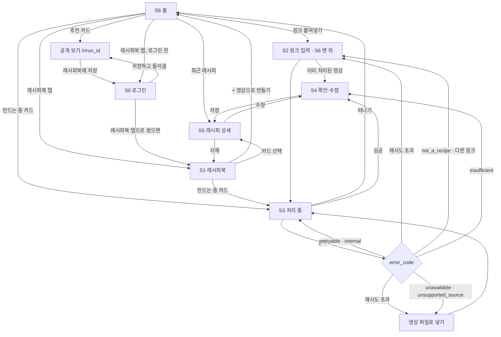

# 숏폼 레시피 서비스 UX 플로우 v0.7

작성: 송유란 · 2026-10-22 · 수정: 2026-11-11 · 팀 검토용
변경: 개발 계획 v0.8(#8)의 화면 범위에 맞춰 다시 씀. 항목별 근거·출처·시각 이동·신뢰도 요약을 화면에서 제외하고, 확인되지 않은 분량은 "영상에서 확인 안 됨"으로 비워 둔다. 실패 안내를 `error_code` 기준 4가지 안내로, 처리 중 화면을 `jobs.stage` 기준으로 바꿈. #9 리뷰 반영: 미확인 분량 문구 변경, 상태 단순화 의도 명시, Shorts 전용 이유, 업로드 원본 보관 표현 통일. #8 병합으로 화면 범위 확정, 절충안은 MVP 이후 검토 후보로 이동. #9 2차 리뷰 반영(10/27): S4 분량 표시를 팀 스키마(`confirmed`/`unconfirmed`) 기준으로, 업로드 실패 안내를 [다른 파일] / [다른 링크]로 나눔, `schema_error`를 `internal`로 합침(#14, 실패 안내 5가지), S2 다른 서비스 링크에 [영상 파일로 넣기] 추가, 흐름도에 재시도 초과·`internal` 분기 추가. 10/28 팀 합의: 로그인 안 했으면 S4는 보기만 되고, 고치려면 로그인한다(KAN-32). 11/2 기획안 v0.8·개발 계획 v0.10(#31) 후속: 차별점 문장을 추정 분량 제안(KAN-52) 기준으로, Shorts 전용 이유와 9절 판단 기준에서 지인 테스트를 뺌. 11/4 개발 계획 v0.11(#34) 후속: Instagram 릴스 연결 뒤 입력 안내, S3 Instagram 실패 사유별 안내, S4 "캡션만 보고 만든 레시피예요" 안내, S5 원본 링크 추가. 11/8 미드 데모 피드백(처음 온 사용자·재방문) 후속, 수빈 초안: 새 홈 S6(링크 입력 + 추천 레시피 + 내 최근 레시피)을 첫 화면으로, 하단 탭 [홈 / 레시피북] 추가, S1은 레시피북 탭으로. 11/11 #46 리뷰 반영(유란): 로그인 전에도 이 브라우저에서 만든 작업이면 S6 "만드는 중" 카드, S3 떠나기·`internal` 버튼을 [홈으로], 추천 저장 뒤 공개 보기로 돌아옴, S2를 S6 맨 위 입력 영역으로 합침, S0 오는 때·탭 없는 화면 정리. "캡션만" 안내는 근거 ID + 원본 링크로 고름(#48).
관련 문서: [기획안](plan.md) · [개발 계획](dev-plan.md)

> **[결정 필요]** 는 팀이 아직 정하지 않은 부분, **[#3 대기]** 는 스키마·API 논의(#3) 결과를 기다리는 부분이다.

## 1. MVP 흐름

**홈 → 링크 입력 → 처리 중 → 레시피 확인·수정 → (로그인) → 저장 → 내 레시피북**

- 링크가 없는 사용자는 홈의 **추천 레시피**를 열어 보고 마음에 들면 레시피북에 저장한다(S6).

- 입력은 **YouTube Shorts 링크**와 영상 파일 업로드. Instagram 릴스는 외부 유료 수집 API로 받기로 했고(10/31, 개발 계획 v0.11), 2회차 실측 뒤 연결한다(KAN-53). 연결 전까지는 S2에서 지원 범위를 안내하고, 연결 뒤 화면은 S2·S3·S4·S5의 "Instagram 연결 뒤" 항목을 따른다.
- 화면 범위는 #8(개발 계획 v0.8)로 **확정**됐다. 확인되지 않은 분량은 비우고(추정 분량 들어오기 전까지), 신뢰도 요약 등 절충안은 MVP에 넣지 않는다. 절충안은 9절 "MVP 이후 검토 후보"에 둔다.
- 결과 화면은 **요리명·재료·원문 분량·조리 순서**만 보여 준다.
- 화면에 넣지 않는 것: 항목별 근거·원문·출처, 영상 시각 이동, 신뢰도 요약, 출처 충돌 표시, 팁·소제목·손질법. 근거·시각·검증 상태는 내부 검증·평가용으로만 쓴다(개발 계획 v0.8).
- 차별점이 화면에 드러나는 곳은 **영상 값과 추정을 섞지 않는 분량 표시**다. 영상에서 확인되지 않은 분량을 영상 값처럼 보여 주지 않는다는 원칙을 사용자가 직접 본다.
  - 지금은 **"영상에서 확인 안 됨"** 으로 비워 둔다.
  - 추정 분량 제안(KAN-52)이 들어오면 추정값을 **"추정"으로 따로 표시**해 제안한다. 추정값은 `amount_status`가 아니라 별도 필드 `amount_estimate`(스키마 v0.3, #3)로 온다. S4 표시 방법은 스키마 v0.3 뒤에 정한다.
  - 로그인 전 공개 링크(`/r/<run_id>`)에서는 추정값을 빼고 빈칸으로 둔다(#3).

## 2. 화면 목록

모바일 웹 기준. 하단 탭은 **[홈 / 레시피북]** 두 개다(11/8). 탭은 S6·S1에만 보인다. S0·S3·S4·S5는 탭 없이 전체 화면으로 열고 [뒤로]를 둔다. 공개 보기(`/r/<run_id>`)는 S4의 로그인 전 화면이라 S4와 같다.

| # | 화면 | 하는 일 | 대표 행동 |
|---|---|---|---|
| S0 | 로그인 | 구글 로그인 | [Google로 계속하기] |
| S6 | 홈 (첫 화면) | 링크 입력(S2), 만드는 중 카드, 추천 레시피 묶음, 내 최근 레시피 | [레시피 만들기] / 추천 카드 |
| S1 | 레시피북 (탭) | 저장한 레시피 전체 목록, "만드는 중" 카드, 빈 상태 | [+ 영상으로 레시피 만들기](→ S6 입력칸) |
| S2 | 링크 입력 (S6 맨 위) | 따로 된 화면이 아니라 S6 맨 위 입력 영역. Shorts 링크 붙여넣기, 영상 파일 대안 | [레시피 만들기] / [영상 파일로 넣기] |
| S3 | 처리 중 | 지금 하는 단계 한 줄, 떠나기 가능, 실패 안내 | [홈으로] |
| S4 | 레시피 확인·수정 | 요리명·재료·분량·순서, 인라인 편집, 직접 입력·되돌리기 | [레시피북에 저장] |
| S5 | 레시피 상세 | 저장한 레시피 보기 | [수정] / [삭제] / [원본 영상] |

## 3. 전체 흐름

## 4. 화면별 내용

### S0 로그인

- 구글 로그인 하나만 둔다. 체험 계정은 없다.
- 오는 때: S4에서 [로그인하고 고치기]를 누를 때, 공개 보기에서 [레시피북에 저장]을 누를 때, 로그인 전에 레시피북 탭을 누를 때, 로그인이 필요한 S1·S5를 열 때. 로그인하면 원래 화면으로 돌아간다.
- 서비스 한 줄 소개 + [Google로 계속하기].

### S6 홈 (첫 화면)

로그인 전·후 같은 홈을 쓴다. 처음 온 사용자가 **넣을 링크가 없어도 바로 써 볼 수 있게**, 다시 올 이유가 보이게 하는 것이 목적이다(미드 데모 피드백, 기획안 v0.9).

위에서 아래로:

1. **링크 입력** — S2가 곧 이 영역이다. 입력칸·[붙여넣기]·지원 범위 검사, 아래 작은 글씨로 [영상 파일로 넣기]. 서비스의 핵심 행동이라 맨 위에 두고, 링크 입력칸은 이 한 곳만 둔다.
2. **"레시피 만드는 중" 카드** — 처리 중인 작업이 있을 때만. 누르면 S3, 실패했으면 S3 실패 상태로 간다(S1과 같음).
   - 로그인했으면 내 작업(`jobs`)을 보여 준다.
   - 로그인 전이면 **이 브라우저에서 만든 작업**을 보여 준다. 로그인 전에 링크를 넣고 S3를 떠난 사람이 만들던 레시피로 돌아올 길이 없어서다. 작업 ID를 브라우저 저장소(localStorage)에 최근 몇 개 기억해 두고 `get_job`으로 상태를 본다. 지금 웹의 `job-source`는 탭을 닫으면 지워지는 sessionStorage에 링크만 기억하므로, 작업 ID 목록은 S6 구현(KAN-56) 때 새로 둔다.
3. **추천 레시피 묶음** — 묶음 제목 한 줄 + 가로로 넘기는 카드. 묶음 2~3개.
   - 카드: 요리명, 크리에이터 이름, 재료 수. 원본 썸네일을 쓸지는 저작권 기준과 같이 정한다. **[결정 필요]**
   - 카드를 누르면 **공개 보기 화면(`/r/<run_id>`)을 그대로** 쓴다. 추정값을 빼고 빈칸으로 두는 규칙도 같다.
   - 공개 보기에서 [레시피북에 저장]을 누르면 로그인(S0) 뒤 저장하고 **같은 공개 보기로 돌아와 저장된 상태**를 보여 준다. 레시피북(S1)으로 보내지 않는다.
   - 첫 묶음 제안: "크리스마스·연말 홈파티", "자취 가성비", "다이어트 도시락", 묶음마다 5개 안팎. 변환과 평가가 한국어 기준이므로 우선 한국어 영상으로 만든다. **[결정 필요]**
4. **내 최근 레시피** — 로그인했으면 최근 저장 3개 + [전체 보기](→ S1). 로그인 전이거나 저장한 레시피가 없으면 "저장한 레시피가 여기 모여요" 한 줄만 둔다.

- 추천 레시피는 팀이 미리 변환해 둔 결과(run)를 묶음 목록으로 관리한다. 저장 방식(테이블 / 정적 파일)은 선규와 정한다. **[결정 필요]**
- 원본 링크·크리에이터 이름을 항상 표시하고, 원작자가 삭제를 요청하면 내린다(기획안 저작권 기준).

### S1 레시피북 (탭)

- 카드: 요리명, 재료 수, 저장일.
- 처리 중인 작업은 맨 위 **"레시피 만드는 중"** 카드로 보여 준다. 누르면 S3, 실패했으면 카드에 실패 표시 후 S3 실패 상태로 간다.
- 동시에 여러 작업을 만들 수 있게 할지(카드 여러 장 vs 하나) — **[#3 대기]**
- 빈 상태: "저장해 둔 요리 숏폼, 텍스트 레시피로 바꿔 보세요." + [영상으로 레시피 만들기].
- [+ 영상으로 레시피 만들기]·[영상으로 레시피 만들기]는 S6 홈으로 가서 링크 입력칸에 커서를 둔다.
- 로그인 전에 레시피북 탭을 누르면 S0으로 간다.

### S2 링크 입력 (S6 맨 위 입력 영역)

따로 된 화면이 아니라 S6 맨 위 입력 영역의 규칙이다.

- 안내: "YouTube Shorts 요리 영상 링크를 붙여 넣어 주세요."
- 입력칸 옆 [붙여넣기] 버튼으로 복사한 링크를 바로 넣는다.
- Shorts 링크가 아니면 버튼을 누르기 전에 입력칸 아래에 알려 준다.
  - 다른 YouTube 링크·형식 오류: "YouTube Shorts 링크가 아니에요."
  - Instagram·TikTok 등: "아직 YouTube Shorts만 지원해요." 아래에 [영상 파일로 넣기]도 같이 보여 줘 막다른 길이 되지 않게 한다.
- **Instagram 연결 뒤(KAN-53):** Instagram 릴스 링크도 받는다.
  - 안내: "YouTube Shorts나 Instagram 릴스 요리 영상 링크를 붙여 넣어 주세요."
  - Instagram 게시물 링크는 주소만으로 릴스인지 사진인지 알 수 없어 입력 단계에서 막지 않는다. 사진·슬라이드 게시물은 S3에서 `ig_not_video`로 안내한다.
  - TikTok 등 다른 서비스는 지금처럼 "아직 YouTube Shorts와 Instagram 릴스만 지원해요." + [영상 파일로 넣기].
- **일반 YouTube(`watch`) 링크는 받지 않는다.** 파이프라인은 처리할 수 있지만 MVP에서는 의도적으로 막는다.
  - 서비스 대상이 "요리 숏폼"이고, 평가셋·정답 데이터도 숏폼 기준이다(일반 YouTube 긴 영상은 없다). 입력 범위를 평가 범위와 맞춰야 보여 주는 품질과 실제 품질이 같다.
  - 긴 영상은 처리 시간·비용이 늘고 레시피 구조(여러 요리, 긴 설명)가 달라 실패 안내가 늘어난다.
  - 길이 제한은 영상을 가져온 뒤에야 알 수 있어 사용자가 기다린 다음 실패를 보게 된다. 링크 형식은 입력하는 순간 알려 줄 수 있다.
  - MVP 이후 일반 링크를 열 때는 길이 제한과 함께 다시 검토한다.
- [영상 파일로 넣기]: "직접 찍었거나 사용 권한이 있는 영상만 올려 주세요. 올린 영상은 레시피를 만든 뒤 지워져요." 업로드 원본은 처리·재시도에 필요한 동안만 임시 보관 후 삭제한다. 정확한 기간은 **[#3 대기]**
- **이미 처리된 영상**이면(같은 영상 재사용) S3를 건너뛰고 바로 S4로 간다.

### S3 처리 중

- 단계 목록 대신 **지금 하는 단계 한 줄**만 보여 준다. 영상마다 실행하는 단계 수가 다르기 때문이다.
  - `jobs.stage` → 문구: 수집 "영상 가져오는 중…" / 음성 "말소리 읽는 중…" / 화면 글자 "화면 글자 읽는 중…" / 정리 "레시피 정리하는 중…"
- 버튼을 비활성화해 같은 링크를 두 번 보내지 않게 한다.
- **화면을 떠날 수 있다.** "화면을 나가도 계속 만들어요. 다 되면 홈에서 볼 수 있어요." + [홈으로]. 로그인 전에는 레시피북을 열 수 없어서 홈의 "만드는 중" 카드로 돌아오게 한다.

**실패 안내** (`error_code` 기준 5가지)

| error_code | 문구 방향 | 행동 |
|---|---|---|
| `retryable` | "잠시 문제가 생겼어요." | [다시 시도] |
| `unavailable` · `unsupported_source` | "이 영상은 링크로 가져올 수 없어요." | [영상 파일로 넣기] / [다른 링크] |
| `not_a_recipe` | "요리 영상이 아닌 것 같아요." | [다른 링크] |
| `insufficient` | "영상에서 찾은 정보가 적어요." | [찾은 만큼 보기] / [다른 링크] |
| `internal` | "서비스에 문제가 생겼어요." | [다시 시도] / [홈으로] |

- 지금 `labels.ts`의 `go_book`([레시피북으로])은 S6 구현(KAN-56) 때 [홈으로]로 바꾼다.
- 정확한 제목·설명·버튼 순서는 Figma "S3 실패 안내 문구표"와 `web/src/lib/api/labels.ts`를 따른다. `reason`이 있으면 `reason`으로 더 자세한 안내를 고른다(#14).
- `internal`은 예전 `schema_error`를 합친 값이다(#14). 서비스 쪽 문제라 사용자에게는 원인을 자세히 말하지 않는다.
- **다시 시도 횟수를 다 쓰면**: "지금은 이 영상을 가져올 수 없어요." + [영상 파일로 넣기] / [다른 링크]. 횟수는 백엔드와 정한다 — **[결정 필요]**
- **업로드한 파일이 실패하면** [영상 파일로 넣기] 대신 **[다른 파일] / [다른 링크]** 를 보여 준다. 위 표의 `unavailable`·`unsupported_source`와 다시 시도 횟수 초과에 모두 해당한다. 이미 파일을 올린 사용자에게 같은 안내를 반복하지 않기 위해서다.
- 재료·단계를 하나도 찾지 못한 경우의 상태값과 화면 — **[#3 대기]**

**Instagram 실패 사유별 안내 (연결 뒤, KAN-53)**

개발 계획 v0.11 2번 표의 `reason`을 화면 안내로 옮긴 것이다. `reason` 이름은 구현 PR(KAN-53)에서 확정되므로, 확정되면 이 표와 `labels.ts`를 같이 맞춘다. 업체 장애와 영상 문제를 나눠, 잠깐 뒤 다시 하면 되는 경우에 "이 영상은 가져올 수 없어요"를 보여 주지 않는 것이 목적이다.

| reason (error_code) | 상황 | 문구 방향 | 행동 |
|---|---|---|---|
| `vendor_transient` (`retryable`) | 수집 업체가 잠깐 안 됨 | "잠시 문제가 생겼어요." | [다시 시도] / [다른 링크] |
| `ig_not_found` · `ig_blocked` (`unavailable`) | 삭제·비공개·접근 제한 | "이 영상은 열 수 없어요. 비공개거나 삭제된 영상일 수 있어요." | [영상 파일로 넣기] / [다른 링크] |
| `ig_not_video` (`unsupported_source`) | 사진·슬라이드 게시물 | "릴스 영상만 가져올 수 있어요." | [다른 링크] / [영상 파일로 넣기] |
| `no_media_no_caption` (`unavailable`) | 음성·영상·캡션 모두 레시피 근거 없음 | "이 영상에서 레시피를 읽을 수 없어요." | [다른 링크] / [영상 파일로 넣기] |
| `vendor_quota` · `vendor_config` (`internal`) | 업체 크레딧·키 문제 | 위 `internal`과 같음. 원인은 사용자에게 말하지 않는다 | [다시 시도] / [홈으로] |

- `ig_not_video`는 같은 게시물을 파일로 올려도 영상이 없으므로 [다른 링크]를 먼저 둔다.
- `no_media_no_caption`도 [다른 링크]를 먼저 둔다. 말소리도 캡션도 없는 릴스는 파일로 올려도 못 읽을 때가 많다. 개발 계획 표와 `labels.ts`의 `no_captions` 순서와도 같다.
- **`vendor_transient`가 다시 시도 횟수를 다 쓰면** 위의 "지금은 이 영상을 가져올 수 없어요." 대신 **"지금은 Instagram 영상을 가져오기 어려워요. 잠시 뒤 다시 해 주세요."** + [영상 파일로 넣기] / [다른 링크]를 보여 준다. 업체가 길게 막혔을 때 영상 탓으로 보이지 않게 하기 위해서다.
- `no_media_no_caption`의 개발 계획 문구("자막이 없어서 읽을 수 없어요")는 Instagram에는 자막이 없어 위처럼 바꿨다. 문구는 KAN-53 구현 PR에서 같이 확정한다.

### S4 레시피 확인·수정 (핵심 화면)

- 순서: 요리명 → (설명 기반 안내) → 재료 목록 → 조리 순서 → 저장.
- **로그인 안 했으면 보기만 된다.** 결과 주소(`/r/<runId>`)는 공개 링크로도 쓰이는데, 링크를 넣은 본인과 링크를 받은 사람을 로그인 없이는 구분할 수 없다. 그래서 로그인 여부로만 나눈다.
  - 로그인 안 함: 요리명·재료·분량·조리 순서를 S5처럼 보여 주고, 맨 아래 [로그인하고 고치기]. 로그인하면 같은 결과의 수정 화면으로 돌아온다.
  - 로그인함: 아래 인라인 편집과 [레시피북에 저장].
- **설명 기반 안내**: 영상 내용 없이 설명란만 읽고 만든 결과면 요리명 아래 한 줄로 알린다. 예: "영상 설명란만 보고 만든 레시피예요." 결과 전체에 한 번만, 항목마다 표시하지 않는다.
  - Instagram 연결 뒤: 음성·영상을 못 받았거나 말소리가 없어 캡션만으로 만든 결과는 **"캡션만 보고 만든 레시피예요."** 로 같은 자리에 보여 준다(개발 계획 v0.11 2번·5번). 영상 분석 결과로 부르지 않는다.
  - 새 API 값 없이 근거 ID와 원본 링크로 고른다(#48, `web/src/lib/review.ts`의 `descriptionNotice`). 근거가 설명란·제목·고정 댓글(`desc-`·`title-`·`comment-`)뿐이면 설명 기반이고, 원본 링크가 Instagram이면 "캡션만", 고정 댓글이 섞였으면 "영상 설명란·고정 댓글만", 아니면 "영상 설명란만"이다. 말소리(`asr-`)나 화면 글자(`ocr-`) 근거가 하나라도 있으면 안내하지 않는다.
- **분량 표시는 세 가지뿐이다.**

| 상태 | 기준 | 화면 | 행동 |
|---|---|---|---|
| 분량 있음 | `amount_status: confirmed` | `amount_raw` 그대로 (예: "1큰술", "약간") | 탭하면 고치기 |
| 영상에서 확인 안 됨 | `amount_status: unconfirmed` (`amount_raw`는 `null`) | 흐린 **"영상에서 확인 안 됨 ✎"** | 탭하면 바로 입력 |
| 직접 입력 | 사용자가 분량을 입력함 | 입력한 값 + **"직접 입력 · 되돌리기"** | [되돌리기]를 누르면 추출 결과로 복원 |

- 화면은 팀 스키마의 RecipeDraft(`schemas/recipe.schema.json`)만 보고 표시한다. **`confirmed`일 때만 `amount_raw`를 보여 주고, 나머지는 모두 "영상에서 확인 안 됨"이다**(개발 계획 v0.8: 확인되지 않은 분량은 비운다. 추정 분량 들어오기 전까지).
- 파이프라인 내부 상태 미확인(`not_in_video`)·확인 필요(`needs_review`)·불일치(`conflict`)는 **어댑터에서 `unconfirmed`로 합쳐지고 `amount_raw`는 비워진다.**
  - 파이프라인 원본 출력은 `needs_review`·`conflict`에도 `amount_text`에 값이 들어 있다. 텍스트가 있는지만 보고 표시하면 비워야 할 분량이 화면에 나오므로, 상태값으로만 판단한다.
  - **의도된 단순화다.** MVP에서는 화면 상태를 줄여 확인·수정 흐름에 집중한다. 내부 상태는 그대로 보관한다.
  - 특히 `conflict`는 영상이 분량을 실제로 말했지만 출처끼리 다른 경우라 "확인 안 됨"과 성격이 다르다. MVP 이후 구분 표시를 다시 검토한다(9절).
- 단위를 바꾸지 않는다. 원문 그대로 보여 준다.
- **인라인 편집**: 따로 편집 모드 없이 화면에서 바로 고친다. 재료 이름·분량·조리 순서 문장을 고칠 수 있다.
- 재료·단계 추가, 삭제, 순서 바꾸기를 지원한다. 추가한 항목도 "직접 입력"으로 표시한다.
- **되돌리기**는 고친 항목에만 보인다. 항목 ID를 유지한 채 그 항목만 추출 결과로 돌아간다. 저장 형식(`user_entered` 등)은 **[#3 대기]**
- 저장 버튼 바로 위 안내: "고친 내용은 원래 결과와 함께 보관되어 추출 품질을 높이는 데 쓰여요."
- 저장 실패 시 고친 내용을 잃지 않고 [다시 저장]을 보여 준다.

### S5 레시피 상세

- S4와 같은 배치를 읽기 전용으로 보여 준다. "영상에서 확인 안 됨"과 "직접 입력" 표시는 그대로 남긴다.
- [원본 영상]: Shorts 링크로 만든 레시피는 YouTube로, Instagram 릴스로 만든 레시피는 Instagram으로 연다. 업로드로 만든 레시피는 원본이 처리 후 삭제되므로(S2와 같음, 기간은 **[#3 대기]**) 버튼을 숨긴다.
- [수정](→ S4), [삭제](확인 대화상자를 거친다).

## 5. 빈 상태·오류 정리

| 상황 | 다음 행동 |
|---|---|
| 저장한 레시피 없음 | [영상으로 레시피 만들기] |
| 지원하지 않는 링크 | 지원 범위 안내, 입력 유지 |
| 처리 실패 | 4절 S3 실패 안내 표 |
| 다시 시도 횟수 초과 | [영상 파일로 넣기] / [다른 링크] |
| 업로드한 파일 실패 | [다른 파일] / [다른 링크] |
| 저장 실패 | 고친 내용 보존 + [다시 저장] |
| 삭제 | 확인 후 삭제, 레시피북으로 이동 |

## 6. 결정 기록

| 항목 | 결정 | 출처 |
|---|---|---|
| 화면 범위 | 근거·출처·시각 이동·신뢰도 요약 제외, 미확인 분량은 비움 | 확정(#8) |
| 미확인 분량 표시 | 흐린 "영상에서 확인 안 됨 ✎", 탭해서 입력 | 유란 (v0.4), 문구는 선규 (#9) |
| 미확인·확인 필요·불일치 | 화면에서는 구분하지 않음(의도된 단순화) | 유란 (v0.4), 선규 (#9) |
| 일반 YouTube 링크 | MVP에서는 받지 않고 Shorts만 | 유란 (#9) |
| 팁·소제목·손질법 | MVP 화면에서 제외 | 유란 (v0.4) |
| 되돌리기 위치 | 고친 항목의 "직접 입력" 표시 옆 | 유란 (v0.4) |
| 같은 영상 재사용 | S3를 건너뛰고 바로 S4 | 유란 (v0.4) |
| S3 단계 표시 | 지금 하는 단계 한 줄만 | 유란 (v0.4) |
| 설명 기반 안내 | 요리명 아래 한 줄, 결과 전체에 한 번 | 유란 (v0.4) |
| 재시도 횟수 초과 | 파일 업로드·다른 링크 안내 | 유란 (v0.4) |
| 업로드 파일 실패 | [다른 파일] / [다른 링크] | 선규 (#9) |
| S4 분량 표시 기준 | 스키마 `amount_status`만 봄. `confirmed`만 `amount_raw` 표시, 내부 3상태는 어댑터에서 `unconfirmed`로 합침 | 선규 (#9) |
| 내부 오류 안내 | `schema_error`를 `internal`로 합침. "서비스에 문제가 생겼어요" + [다시 시도] | 수빈 (#14) |
| 품질 개선 안내 위치 | 저장 버튼 바로 위 | 유란 (v0.4) |
| 입력 범위 | YouTube Shorts + 영상 파일. Instagram 릴스는 외부 유료 수집 API로, 2회차 실측 뒤 연결 | 개발 계획 v0.11 (#34) |
| Instagram 실패 안내 | 업체 장애(`vendor_transient`)는 다시 시도, 삭제·비공개는 파일 업로드 안내로 나눔 | 유란 제안·수빈 반영 (#34) |
| 캡션만으로 만든 결과 | "캡션만 보고 만든 레시피예요", 설명 기반 안내와 같은 자리. 근거 ID + 원본 링크로 판단, 새 API 값 없음 | 개발 계획 v0.11 (#34), 판단 기준 유란 (#48) |
| 홈 | S6 홈(링크 입력 + 추천 레시피 + 내 최근 레시피), 로그인 전·후 같은 홈. S1 레시피북은 탭으로 (예전: S1 레시피북이 홈, 선규 #4) | 미드 데모 피드백 후속, 수빈 제안 (11/8) |
| 하단 탭 | [홈 / 레시피북] 두 개. S6·S1에만 보이고 S0·S3·S4·S5·공개 보기는 탭 없이 [뒤로] | 수빈 제안 (11/8), 탭 없는 화면 유란 (#46) |
| 링크 입력 위치 | S6 맨 위 한 곳. S2는 이 영역이고, S1의 [+ 영상으로 레시피 만들기]는 홈 입력칸으로 | 유란 제안 (#46) |
| 로그인 전 "만드는 중" 카드 | 이 브라우저에서 만든 작업이면 S6에 보여 줌 | 유란 제안 (#46) |
| S3 떠나기·`internal` 버튼 | [레시피북으로] 대신 [홈으로] | 유란 제안 (#46) |
| 추천 저장 뒤 | 로그인 → 저장 → 같은 공개 보기(저장됨)로 돌아옴 | 유란 제안 (#46) |
| 추천 카드 화면 | 공개 보기(`/r/<run_id>`) 재사용 | 개발 계획 v0.10 (#31) |
| 수정 방식 | 인라인 편집 | 선규 (#4) |
| 처리 중 떠나기 | 허용 + S6·S1 "만드는 중" 카드, 떠나면 홈으로 | 선규 (#4), 11/8 S6 추가, 홈으로 유란 (#46) |
| 로그인 | 구글 로그인, 체험 계정 없음 | 선규 제안·유란 동의 (#6) |
| S4 로그인 전 | 보기만. 고치려면 [로그인하고 고치기] (저장할 때 로그인 → 고칠 때 로그인으로 바꿈) | 유란 제안·팀 합의 (10/28, KAN-32) |
| 신뢰도 요약 등 절충안 | MVP에서 제외, 9절 검토 후보로 보관 | 확정(#8), 선규 (#9) |

## 7. 남은 질문

**#3에서 정할 것**
1. 직접 입력한 분량·추가한 항목의 저장 형식(`user_entered` 등)
2. 재료·단계를 하나도 못 찾았을 때 상태값과 S4 표시
3. 동시에 여러 작업 허용 여부(S1 "만드는 중" 카드 개수)
4. 업로드 원본의 임시 보관 기간

**팀에서 정할 것**
5. 다시 시도 횟수
6. 추천 묶음 주제·개수, 한국어/영어 영상, 썸네일 사용 여부(S6)
7. 추천 레시피 저장 방식(S6, 선규)

## 8. 다음 단계

와이어프레임은 v0.4에 맞춰 고쳤다(S0·S5 추가, S3 한 줄 표시, S4 "영상에서 확인 안 됨"·되돌리기). 1주차에는 S0 → S2 → S3 → S4를 실제 API에 연결하는 것이 목표다.

## 9. MVP 이후 검토 후보

MVP에는 넣지 않지만 지우지 않고 남겨 둔다. 지인 테스트는 하지 않기로 했으므로(기획안 v0.8) 팀 내부 확인과 서비스 로그(수정한 항목 수·저장 완료 여부, 4주차 수빈 집계)로 판단한다. 분량을 고친 항목이 많거나 저장까지 가지 못한 결과가 많으면 아래 후보를 먼저 꺼낸다.

| 후보 | 내용 | 다시 볼 때 |
|---|---|---|
| S1 카드 "분량 확인 필요 N" | 레시피 카드에 영상에서 확인 안 된 분량 개수 표시 | 사용자가 어떤 레시피를 먼저 고쳐야 할지 모를 때 |
| S4 맨 위 집계 한 줄 | "재료 12개 중 10개 분량 확인"처럼 확인된 분량 비율 표시 | 영상을 다시 볼지 판단하기 어려워할 때 |
| `conflict` 구분 표시 | 출처끼리 분량이 다를 때 "확인 안 됨"과 구분 | 영상이 분량을 말했는데 "확인 안 됨"으로 보여 혼란스러울 때 |
| 일반 YouTube 링크 | `watch` 링크 허용 + 길이 제한 | 사용자가 Shorts가 아닌 링크를 자주 넣을 때 |
