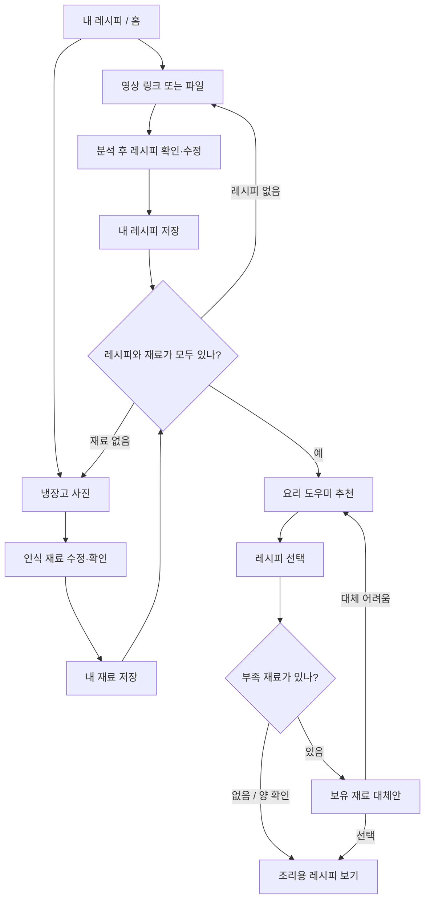

# 숏폼 레시피 서비스 UX 플로우 v0.1

작성일: 2026-10-18 · 팀원 수정용 초안
관련 문서: [기획안](숏폼 레시피 서비스 기획안.md) · [개발 계획](숏폼 레시피 서비스 개발 계획.md)

## 화면 구조

모바일 웹 기준, 하단 탭은 **내 레시피 / 내 냉장고 / 요리 도우미** 세 개다. 첫 화면은 내 레시피를 제안한다. 데모는 체험 계정으로 시작하고 공개 버전의 개인 데이터는 사용자별로 분리한다.

| 화면 6종 | 주요 내용 | 대표 행동 |
|---|---|---|
| 내 레시피/홈 | 저장 카드, 영상 추가, 냉장고 상태 | 영상 추가 / 지금 재료로 추천 |
| 영상 추가 | 링크·파일 입력, 분석 중·실패 | 레시피 만들기 |
| 레시피 상세 | 출처, 재료·분량, 순서, 수정 | 저장 / 이 레시피 가능할까? |
| 내 냉장고 | 확정 재료, 마지막 확인 날짜 | 사진 추가 / 직접 수정 |
| 인식 결과 확인 | 후보 수정·삭제·누락 추가, 선택적 양 입력 | 이 재료로 저장 |
| 요리 도우미 | 추천 카드, 조건 입력, 대체 안내 | 레시피 보기 / 없는 재료 대체 |

분석 중·실패·대체 안내는 화면 안 상태나 시트로 처리해 이동을 줄인다.

## 전체 흐름



## 첫 사용

1. 홈: “저장한 요리, 지금 있는 재료로 해먹어요.” [영상 추가]와 [냉장고부터 등록].
2. 영상 입력 → 결과 먼저 표시. 모든 분량을 채우도록 강제하지 않는다.
3. 저장 후 “지금 만들 수 있는지 확인할까요?” → [냉장고 찍기].
4. 사진 후보 수정·저장 → [이 재료로 추천받기].
5. 추천 선택 → 저장 원본과 보유/부족/양 미확인 재료 → 필요하면 대체안.

사진부터 시작하면 재료 저장 후 “해먹고 싶은 영상 하나를 추가해보세요”로 연결한다. 순서를 강제하지 않는다.

## 영상 입력 → 결과

입력에는 지원 범위를 안내한다. 분석 중 확인 가능한 상태를 보여주고 중복 제출을 막는다. 결과는 요리명→재료→순서이며 출처를 볼 수 있다. 원문 분량을 보존하고 불명확하면 “분량 확인 필요”를 표시한다.

링크 접근 실패에는 [다시 시도]·[영상 파일로 넣기], 정보 부족에는 확보된 결과 수정·저장 또는 [다른 영상 넣기]를 제공한다. 영상에 없는 완성 레시피를 추출 결과처럼 만들지 않는다.

## 냉장고 촬영 → 확인

촬영 안내: “보이는 재료만 찾을 수 있어요. 가려진 곳은 나눠 찍어주세요.” 카메라 권한이 없어도 사진 업로드로 진행한다.

후보 목록은 이름 수정·삭제·체크와 [+ 빠진 재료]를 제공한다. 양은 선택 입력이다. 사진에서 셀 수 있어 보여도 사용자가 확인하지 않은 개수는 추정/미확인이다.

재촬영은 기존 목록과 새 후보를 비교해 병합한다. 사진에서 안 보였다는 이유만으로 기존 재료를 삭제하지 않는다. 저장 후 재료 수·마지막 확인 날짜와 [추천받기]를 보여준다.

## 추천 → 대체

빈 채팅창 대신 [지금 재료로 추천]으로 시작한다. 조건은 “빨리 만들기”, “특정 재료 쓰기” 정도부터 제공하며 판단 정보가 없으면 확인 필요로 남긴다.

카드 예시:

```text
두부조림 · 내 저장 레시피
추천 이유: 확인한 두부와 대파를 활용할 수 있어요.
있음: 두부, 대파
확인 필요: 간장·기본 양념 / 재료별 남은 양
[레시피 보기] [부족 재료 확인]
```

결과 상태는 데이터에 맞춰 “보유 재료가 맞아요”, “대체안이 있어요”, “추가 재료가 필요해요”로 표현한다. 양 미확인은 별도로 표시한다.

같은 도우미에서 [이 재료 없어요]를 누르면 선택 레시피를 유지한 채 보유 대체 후보·이유·필요량·맛/과정 변화·불확실성을 보여준다. 대체가 어렵다면 다른 저장 레시피를 제안한다.

[이 대체로 보기]는 조리용 사본의 바뀐 부분을 표시한다. 원본 보기·되돌리기를 제공한다. 원본 자동 덮어쓰기와 재고 자동 차감은 하지 않는다.

## 빈 상태·오류

| 상황 | 다음 행동 |
|---|---|
| 저장 레시피 없음 | 영상 하나 추가 |
| 냉장고 미등록 | 사진 / 직접 재료 입력 |
| 재료 인식 실패 | 재촬영 / 직접 추가 |
| 인식 오류 | 후보 수정·삭제·누락 추가 |
| 적합한 저장 레시피 없음 | 부족 재료 안내, 다른 영상 저장 / 재료 수정 |
| 오래된 냉장고 목록 | 마지막 확인 날짜와 재확인 |
| 에이전트 실패 | 선택·입력을 보존하고 재시도 |
| 저장 실패 | 작성 내용을 보존하고 재시도 |

## 10/20 목업과 시연

6종 화면의 성공 흐름을 클릭 가능하게 만들고 대표 로딩·실패·빈 상태를 준비한다. 시각 스타일은 임시여도 된다.

실제 MVP에서는 선정 영상 1개 분석→저장, 냉장고 사진 1장→확인, 추천→대체까지 연결한다. 영상·사진 각 3개를 후보로 준비한다. 샘플 모드/시연 녹화는 백업임을 표시한다.

## 팀 리뷰 질문

1. 홈을 내 레시피로 할지 요리 도우미로 할지?
2. 저장 직후 냉장고 등록 제안이 자연스러운지?
3. 후보 수정 부담은 어느 정도이며 양은 언제 물을지?
4. 추천 이유·부족 재료가 한눈에 이해되는지?
5. 대체 후 원본과 바뀐 부분이 분명한지?

지인 테스트에서는 저장→재료 확인→추천 도달 과정의 시간과 막힌 지점을 기록한다. 유란이 이 초안으로 목업을 만들고 세 명이 수정한다.
